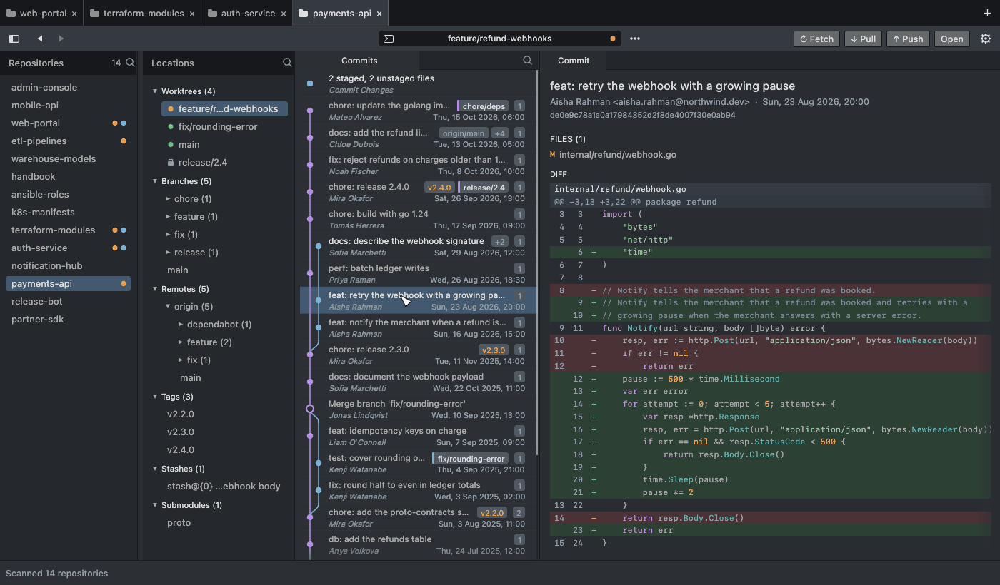
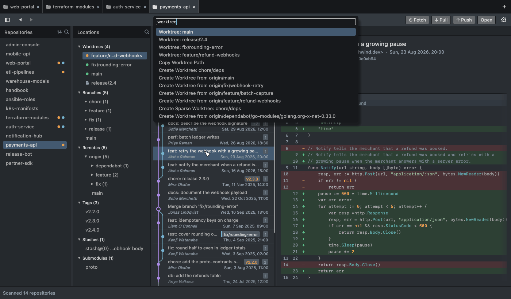

<p align="center">
  
</p>

<h1 align="center">HydraMerge</h1>

<p align="center">
  <b>A git client for the one-folder-per-branch workflow.</b><br>
  Every repository and every worktree in one window. Native, fast, and it never runs <code>checkout</code>.
</p>

<p align="center">
  <a href="https://github.com/HydraMerge/hydra-merge/actions/workflows/ci.yml?query=branch%3Amain"></a>
  <a href="https://github.com/HydraMerge/hydra-merge/actions/workflows/codeql.yml?query=branch%3Amain"></a>
  <a href="https://github.com/HydraMerge/hydra-merge/actions/workflows/release.yml"></a>
  <a href="LICENSE"></a>
  <a href="https://github.com/HydraMerge/hydra-merge/releases"></a>
  <a href="https://github.com/HydraMerge/hydra-merge/releases/latest"></a>
</p>

<p align="center">
  <a href="https://github.com/HydraMerge/hydra-merge/releases/latest">Download</a> ·
  <a href="#quick-start">Quick start</a> ·
  <a href="docs/guide.md">Guide</a> ·
  <a href="docs/spec.md">Spec</a>
</p>

<p align="center">
  <picture>
    <source media="(prefers-color-scheme: light)" srcset="docs/screenshots/commit-light.png">
    
  </picture>
</p>

## Why

`git worktree` gives every branch its own folder, so you stop stashing and switching. The price is that
the folders are scattered, and plain git shows one of them at a time. Which worktree has uncommitted
changes? Which branch has no folder yet? Where did that MR branch go?

HydraMerge answers that at a glance. Point it at `~/repos`, and it lists every repository with an orange dot
where something is uncommitted, every worktree with a clean / modified state, and the history, changes and diff of
whichever one you click.

```
~/repos/group/project/
  .bare/          the git directory, once
  master/         worktree for master
  feature/login/  worktree for feature/login
```

## What you get

| | |
|---|---|
| **See everything** | All repositories under your scan folder, all worktrees of each, with clean / modified / locked state. |
| **Create in one click** | A worktree for a local or remote branch lands at `<repo>/<branch>`, tracking set up. A sparse worktree holds only the folders you pick. Remove a clean one after one confirmation. |
| **Work in place** | Commit graph, diffs with syntax colours, stage, commit, fetch, pull, push. Open the folder in Sublime Text, VS Code, Cursor, Zed, a JetBrains IDE or Terminal. |
| **Keyboard first** | `Cmd+Shift+P` command palette over every action, back / forward, filters. |
| **Safe by design** | No `checkout`, `reset`, `clean` or `--force`, ever; merge and rebase only after you confirm. Hooks and filters of an untrusted repository do not run until you say so. |
| **Yours** | Nine built-in skins and your own as a small text file. macOS, Windows, Linux, x86_64 and arm64, one binary, no server. |

<p align="center">
  
</p>

## Quick start

1. [Install](#install) HydraMerge.
2. Keep your repositories under one folder (`~/repos` by default; change it in **Settings → Scan Folder…**).
   A normal clone works as it is. For one folder per branch:

   ```
   mkdir -p ~/repos/group/project
   git clone --bare <url> ~/repos/group/project/.bare
   git -C ~/repos/group/project/.bare worktree add ~/repos/group/project/master master
   ```

3. Start the app. Pick a repository on the left, a worktree in **Locations**, and work.

More on layouts, existing clones and settings: [docs/guide.md](docs/guide.md#prepare-a-repository).

## Install

Download the archive for your system from the [latest release](https://github.com/HydraMerge/hydra-merge/releases/latest).
Archives are named `hydra-merge-<tag>-<target>`, with the targets from the table under
[Build and run](docs/guide.md#build-and-run), and `SHA256SUMS` lists their checksums:

```
shasum -a 256 -c SHA256SUMS --ignore-missing
```

Each archive also carries a signed build provenance attestation (from v0.1.15): it proves the file was built
by this repository's release workflow from the tagged commit. Check it with the GitHub CLI:

```
gh attestation verify hydra-merge-<tag>-<target>.zip --repo HydraMerge/hydra-merge
```

**macOS**: unzip `hydra-merge-<tag>-aarch64-apple-darwin.zip` (Apple silicon) or `-x86_64-apple-darwin.zip` (Intel)
and move `HydraMerge.app` to `/Applications`. The build is not notarized, so clear the quarantine flag once:

```
xattr -dr com.apple.quarantine /Applications/HydraMerge.app
```

**Linux and Windows**: unpack the `.tar.gz` and run `hydra-merge` (`hydra-merge.exe` on Windows).

Later versions arrive through [Updates](docs/guide.md#updates).


## More

- [Guide](docs/guide.md): all features, environment variables, skins, files it writes, updates, keyboard shortcuts.
- [Spec](docs/spec.md): the contract the app and its tests follow.
- Build from source: `cargo run --release` (Rust stable, git 2.20+). See [Build and run](docs/guide.md#build-and-run).

## License

[MIT](LICENSE).
